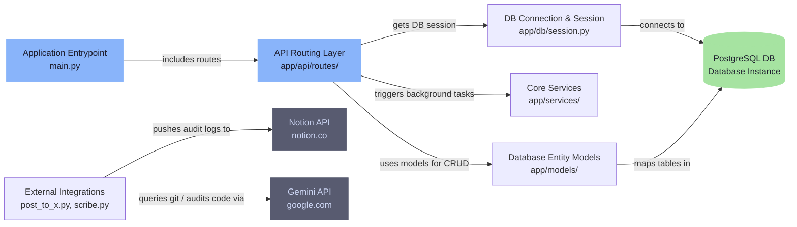
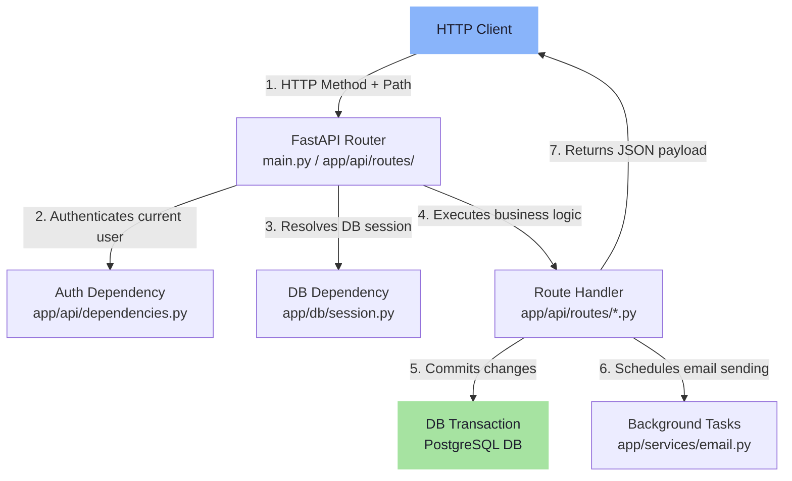
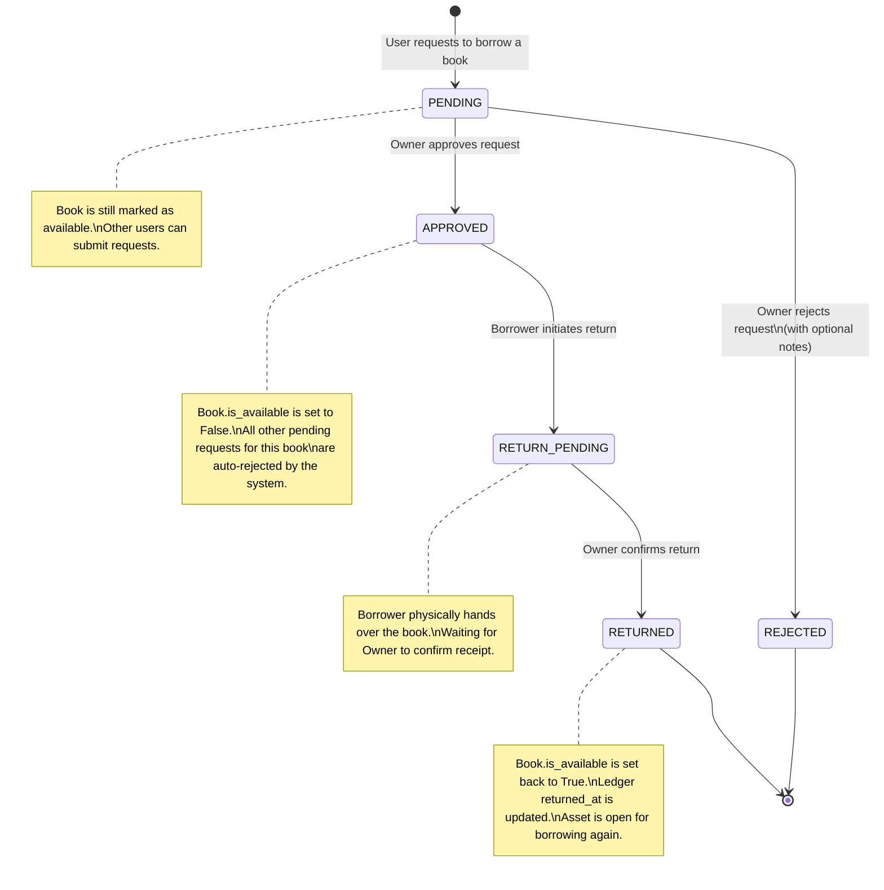

# 📚 HLAD Library API

> **The backend microservice powering peer-to-peer book sharing for the Hindi Literary and Debating Club (HLAD) at National Institute of Technology, Kurukshetra (NIT KKR).**

---

## 📖 Introduction & Context

The **HLAD Library API** is a custom-built, lightweight peer-to-peer (P2P) library system designed for the members of the **Hindi Literary and Debating Club (HLAD), NIT Kurukshetra**. 

Within a literary club, books (literary classics, debating guides, poetry collections, novels) are highly valued assets. Rather than maintaining a centralized physical library which requires rent, management overhead, and space, this system enables **peer-to-peer book sharing**. Club members list books they own, request to borrow books from other members, and track loans through a transparent system of digital handshakes, automated email notifications, and trust scores.

---

## ⚡ Key Features

- **P2P Cataloging**: Any active member can list books they own to make them available to the club.
- **Double-Handshake Lifecycle**: Book loans go through a validation state machine where both parties must confirm changes (Borrow Request -> Owner Approval -> Borrower Return -> Owner Receipt Confirmation).
- **Overlapping Request Resolution**: When a book owner approves a borrow request, the system automatically rejects all other concurrent pending requests for that book with an automated notification.
- **Reputation-based Trust Score**: Every member starts with a `trust_score` of 100, which can be modified based on borrowing behavior (timely returns, book condition, etc.).
- **Just-in-Time Provisioning**: Automatic account provisioning in the library database upon receiving a valid external JWT from the main Next.js portal.
- **Asynchronous Mail Notification Loop**: Utilizes FastAPI `BackgroundTasks` to send rich HTML emails for important status updates (new requests, approvals, return handshakes).
- **Builder-in-Public Developer Utilities**: Built-in developer automation scripts that parse Git diffs via the Gemini API to auto-generate development logs in Notion databases and draft dev updates for X (Twitter).

---

## 🛠️ Tech Stack

| Technology | Purpose |
| :--- | :--- |
| **Python 3.10+** | Language Runtime |
| **FastAPI** | High-performance ASGI Web Framework |
| **SQLModel** | ORM combining **Pydantic** validation & **SQLAlchemy** queries |
| **PostgreSQL** | Relational Database |
| **Alembic** | Database Migrations & Version Tracking |
| **PyJWT** | JWT Authentication and token validation |
| **Google Gemini API** | AI-powered code changes audit & social post drafting |
| **Notion Client** | Automated logging of developer logs to Notion databases |

---

## 📐 System Architecture

### 1. Overall System Architecture
The backend microservice is organized as a layered API:
- **`main.py`**: The application entry point and router aggregator.
- **`app/api/routes/`**: Handles endpoint paths, user authorization dependencies, and API request schemas.
- **`app/db/session.py`**: Configures the PostgreSQL connection engine with connection pooling (`pool_size=10`, `max_overflow=20`, and `pool_pre_ping=True` to prevent stale database connections).
- **`app/models/`**: Defines relational tables and SQLModel entities.
- **`app/services/email.py`**: Manages SMTP integrations for automated alerts.
- **`scribe.py` & `post_to_x.py`**: Independent developer automation scripts interfacing with external APIs.



### 2. Request Processing Flow
Every HTTP request follows a structured security and database session resolution pipe before executing domain logic.



### 3. Borrow Request State Machine
A core feature of the API is maintaining transaction integrity during the book borrowing process. The status of a `BookRequest` changes as follows:



---

## 🗄️ Database Schema & Models

SQLModel is used to map database entities directly to PostgreSQL tables.

### 1. Entity Relationship Overview
- A `LibraryUser` can own many `Book`s.
- A `LibraryUser` can submit many `BookRequest`s (as a borrower).
- A `Book` can be associated with many `BookRequest`s and `BorrowLedger` entries.
- A `BorrowLedger` logs borrowing history, matching a `LibraryUser` (borrower) to a `Book`.

### 2. Schema Specification

#### `library_user` (represented by [LibraryUser](file:///app/models/user.py))
Represents a student or library member registered within the ecosystem.
- `id` (VARCHAR(24), Primary Key): Unique 24-character hexadecimal profile ID generated by the parent service.
- `email` (VARCHAR(255), Unique, Indexed, Nullable=False): Student email.
- `trust_score` (INTEGER, Default=100, Nullable=False): User reputation (0-100).
- `is_active` (BOOLEAN, Default=True, Nullable=False): Soft-deactivation toggle.
- `version_id` (INTEGER, Default=1, Nullable=False): Used for record versioning/optimistic locking.

#### `book` (represented by [Book](file:///app/models/book.py))
Stores books owned by individuals and shared in the peer network.
- `id` (UUID, Primary Key, Default=UUID4): Unique identifier of the specific book copy.
- `title` (VARCHAR(255), Indexed, Nullable=False): Title of the book.
- `owner_id` (VARCHAR(24), ForeignKey -> `library_user.id`, Indexed, Nullable=False): The club member who owns this book.
- `is_available` (BOOLEAN, Default=True, Nullable=False): Indicates if the book is currently in its owner's custody and available to be borrowed.
- `is_deleted` (BOOLEAN, Default=False, Indexed, Nullable=False): Soft-delete indicator for books permanently removed from circulation.

#### `book_request` (represented by [BookRequest](file:///app/models/request.py))
Keeps track of request tickets, handling the P2P transaction state.
- `id` (INTEGER, Primary Key, Auto-increment): Unique request ID.
- `receiver_id` (VARCHAR(24), ForeignKey -> `library_user.id`, Indexed, Nullable=False): The user requesting to borrow the book.
- `book_id` (UUID, ForeignKey -> `book.id`, Indexed, Nullable=False): The requested book.
- `status` (Enum/VARCHAR, Default='pending', Indexed, Nullable=False): Current request status (`pending`, `approved`, `rejected`, `canceled`, `expired`, `return_pending`, `returned`).
- `owner_notes` (VARCHAR(255), Nullable=True): Notes/rejection reasons provided by the owner.
- `created_at` (TIMESTAMP, Default=UTC_NOW, Nullable=False): Creation timestamp.
- **Constraints & Indexes**:
  - `uq_active_user_book_request`: A unique partial index on `(receiver_id, book_id)` specifically filtered for active request states (`status IN ('pending', 'approved', 'return_pending')`). This prevents a borrower from spamming multiple concurrent requests for the same book copy.

#### `borrow_ledger` (represented by [BorrowLedger](file:///app/models/ledger.py))
Stores immutable transaction logs for book exchanges.
- `id` (INTEGER, Primary Key, Auto-increment): Unique log ID.
- `user_id` (VARCHAR(24), ForeignKey -> `library_user.id`, Indexed, Nullable=False): The borrowing student.
- `book_id` (UUID, ForeignKey -> `book.id`, Indexed, Nullable=False): The borrowed book copy.
- `borrowed_at` (TIMESTAMP, Default=UTC_NOW, Nullable=False): Date and time the book was borrowed.
- `due_date` (TIMESTAMP, Default=UTC_NOW + `settings.LENDED_DAYS`, Nullable=False): Return deadline.
- `returned_at` (TIMESTAMP, Nullable=True): Timestamp of confirmed return. `None` represents an active loan.

---

## 🔌 API Endpoints Reference

All endpoints (except `/token` and `/health`) require a valid JWT passed in the HTTP Authorization header as `Bearer <token>`.

### Authentication & Health Check
| Endpoint | Method | Description | Auth Required |
| :--- | :--- | :--- | :--- |
| `/health` | `GET` | Service status check and DB connectivity verification. | No |
| `/token` | `POST` | **Mock Authorization**: Generates a JWT token for a specific user ID (sent as URL-encoded form parameter `username`). | No |

### User Management
| Endpoint | Method | Request Payload | Response Schema | Description |
| :--- | :--- | :--- | :--- | :--- |
| `/user/` | `POST` | `UserCreate` (id, email) | `UserResponse` (id, trust_score) | Manages explicit registration of club members. |

### Books Catalog
| Endpoint | Method | Request Payload / Query Params | Response Schema | Description |
| :--- | :--- | :--- | :--- | :--- |
| `/books/` | `POST` | `BookCreate` (title) | `BookResponse` | Registers a book copy under the authenticated user's ownership. |
| `/books/` | `GET` | `offset` (default 0), `limit` (default 20) | `list[BookResponse]` | Fetches all available and non-deleted books. |

### Active Loans Dashboard (Ledger)
| Endpoint | Method | Response Schema | Description |
| :--- | :--- | :--- | :--- |
| `/ledger/borrowing` | `GET` | `list[ActiveLoanResponse]` | **Borrower's view**: Lists books the current user is holding and their due dates. |
| `/ledger/lending` | `GET` | `list[ActiveLoanResponse]` | **Lender's view**: Lists books owned by the current user that are lent out. |

### Request Queue & Lifecycle Handshake
| Endpoint | Method | Request Payload | Response Schema | Description |
| :--- | :--- | :--- | :--- | :--- |
| `/request/` | `POST` | `BookRequestCreate` (book_id) | `BookRequestResponse` | Submits a borrow request for a book. |
| `/request/{id}/act` | `POST` | `RequestActionPayload` (action, owner_notes) | `BookRequestResponse` | **Owner Action**: Approves or rejects a pending borrow request. |
| `/request/borrower` | `GET` | *None* | `list[BookRequestResponse]` | Retrieves requests submitted by the logged-in user. |
| `/request/owner` | `GET` | *None* | `list[BookRequestResponse]` | Retrieves requests received for books owned by the logged-in user. |
| `/request/{id}/return` | `POST` | *None* | `BookRequestResponse` | **Borrower Action**: Initiates book return (`APPROVED` -> `RETURN_PENDING`). |
| `/request/{id}/confirm-return` | `POST` | *None* | `BookRequestResponse` | **Owner Action**: Confirms receipt (`RETURN_PENDING` -> `RETURNED`). |

---

## 📧 Automated Notification System

The system ensures smooth off-platform coordination by sending automated HTML emails using FastAPI's asynchronous background task queue:
1. **New Request**: Sent to the **Owner** when a student requests their book.
2. **Approval / Rejection**: Sent to the **Borrower** once the owner decides on the request.
3. **Return Handshake Initiated**: Sent to the **Owner** when the borrower initiates a return, prompting the owner to check for physical receipt.
4. **Return Confirmed**: Sent to the **Borrower** confirming that the transaction is successfully closed.

---

## 🤖 Developer Productivity Suite (Build in Public)

To support transparency and a modern "building in public" workflow within the club, the project contains two developer automation files:

### 1. Git Audit Scribe (`scribe.py`)
Automatically logs commits to a central **Notion database**:
- Compiles git diffs using `git diff origin/main...HEAD`.
- Leverages the **Google Gemini API** (`gemini-2.5-flash`) with a custom system prompt to analyze the code delta.
- Structurally summarizes the changes into 3 sections: **Deep Concepts Unboxed**, **Structural Implementations**, and **Optimization Opportunities & Risks**.
- Saves the resulting high-signal summary directly to a Notion page.

### 2. Social Poster (`post_to_x.py`)
Generates high-engagement updates for X/Twitter:
- Extracts the latest Git commit message and changes.
- Instructs Gemini to craft a punchy, developer-centric update following the *Engineering Journey* layout (Hook, Value, and Geek Drop) without corporate boilerplate.

---

## ⚙️ Local Development Setup

Follow these steps to set up and run the service locally.

### Prerequisites
- Python 3.10 or higher
- PostgreSQL database
- Git

### 1. Clone & Configuration
Clone the repository:
```bash
git clone https://github.com/Sulemankhannit/hlad-library-api.git
cd hlad-library-api
```

Create a `.env` file in the root folder and populate it with the following configuration:
```env
# Database Configuration
DATABASE_URL="postgresql://<user>:<password>@localhost:5432/<dbname>"

# Security & JWT Configuration
JWT_SECRET="your-super-secure-jwt-secret-key"
JWT_ALGORITHM="HS256"
ACCESS_TOKEN_EXPIRE_MINUTES=1440
LENDED_DAYS=14

# SMTP Configuration (For automated emails)
SMTP_HOST="smtp.gmail.com"
SMTP_PORT=465
SMTP_USER="your-club-email@gmail.com"
SMTP_PASSWORD="your-app-specific-gmail-password"

# Developer Automation Integrations (Optional)
NOTION_TOKEN="secret_notion_integration_token"
NOTION_DATABASE_ID="notion_database_uuid"
GEMINI_API_KEY="google_gemini_api_key"
```

### 2. Install Dependencies
Set up a Python virtual environment and install the required libraries:
```powershell
# Create virtual env
python -m venv venv

# Activate virtual env
# On Windows (PowerShell):
.\venv\Scripts\Activate.ps1
# On Linux/macOS:
source venv/bin/activate

# Install requirements
pip install -r requirements.txt
```

### 3. Run Database Migrations
Apply database migrations using Alembic to create and update tables:
```bash
alembic upgrade head
```

### 4. Start the Application
Launch the FastAPI server using Uvicorn:
```bash
uvicorn main:app --reload
```
Once started, the API documentation is available interactively at:
- Swagger UI: [http://127.0.0.1:8000/docs](http://127.0.0.1:8000/docs)
- ReDoc: [http://127.0.0.1:8000/redoc](http://127.0.0.1:8000/redoc)

---

## 🧪 Testing

The repository uses `pytest` for unit and integration tests.
To run the security and endpoint authorization tests, execute:
```bash
pytest
```
Test suite location: [tests/test_security.py](file:///tests/test_security.py).

---

## ☁️ Deployment

The project is structured to deploy seamlessly as a serverless Python microservice on **Vercel** via the setup in [vercel.json](file:///vercel.json).
To deploy:
1. Install the Vercel CLI: `npm i -g vercel`
2. Run `vercel` in the root directory.
3. Configure the environment variables in the Vercel Dashboard project settings.

---

🛠️ Built with ❤️ by **Suleman** & the **HLAD Dev Team**, NIT Kurukshetra.

